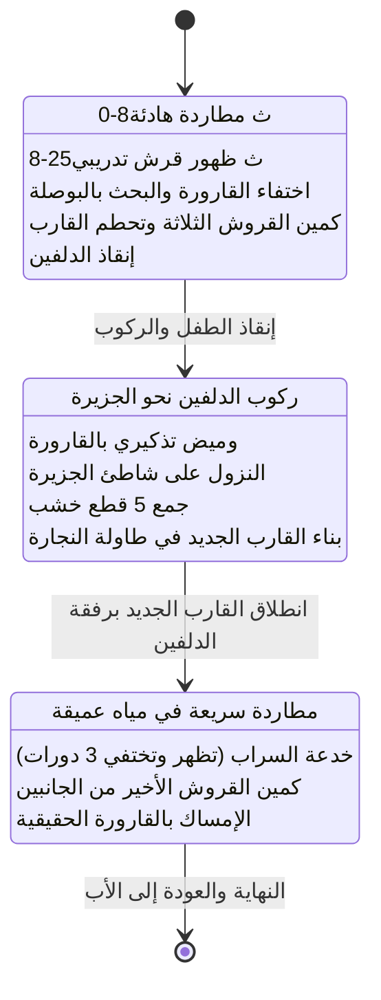

# مشروع فتى البحر — دليل الأصول والتحويل البرمجي
## KID OF THE SEA — Assets & Engine Migration Blueprint

---

### 1. الجملة الحاكمة وهوية المشروع (Core Vision)
> **"طفل يطارد قارورته الضائعة في بحر واسع، فيخسر قاربه ويكسب صديقاً، ويكتشف ما الذي كان يبحث عنه فعلاً."**

* **النوع:** مغامرة بحرية توب-داون (Top-Down Ocean Adventure).
* **الهدف المحوري:** مطاردة القارورة المفقودة (وليس كنزاً)، وفقدان القارب لصالح صداقة الدلفين وإعادة بنائه.
* **الأسلوب البصري:** رسومات يدوية سينمائية دافئة + محاكاة أمواج مائية ناعمة.

---

### 2. بنية المجلد المستقل (Standalone Project Structure)

المشروع في هذا المجلد تم تنظيفه بالكامل من كافة الملفات المؤقتة والمسودات، ويحتوي حصرًا على **الملفات الأساسية الصالحة للتشغيل أو للتحويل الفوري لأي محرك ثانٍ (Unity / Godot / Phaser / Unreal)**:

```text
BOAT_KID_STANDALONE/
├── index.html                   # نقطة الدخول الرئيسية وتوجيه الصفحة
│
├── MAIN MENU/                   # واجهة البداية السينمائية
│   ├── index.html               # واجهة القائمة الرئيسية الحديثة
│   ├── BG-MENU.mp4              # فيديو الخلفية الحلقي للواجهة
│   └── TRANSITION-TOPLAY.mp4    # فيديو الانتقال السلس إلى أسلوب اللعب
│
├── LEVEL/                       # محرك اللعبة الأساسي (Core Engine)
│   ├── game.html                # صفحة اللعبة الأساسية ولوحة الـ Canvas والواجهات (HUD)
│   ├── book.html                # قصة المانجا التمهيدية التفاعلية (Comic Book Cutscene)
│   ├── Weathered Blue Rowboat with Oars.png  # صورة القارب الخشبي الراسي على الشاطئ
│   ├── Glossy Blue-Collar Baby Bottle.png   # صورة قارورة الحليب التائهة في البحر
│   ├── story_frame.png          # إطار المشاهد القصصية
│   ├── story images/            # 10 لوحات قصصية مصورة للمقدمة (02 إلى 12)
│   ├── css/                     # ملفات التنسيق الكاملة (game, hud, hud_aaa, story, tutorial)
│   └── js/                      # محرك الجافاسكريبت المعياري النظيف (16 ملفاً)
│       ├── config.js            # مصفوفات الأصول وإعدادات المراحل والمؤقتات
│       ├── state.js             # آلة الحالات (State Machine) وحفظ التقدم والـ Core Loop
│       ├── render.js            # مصير الكانفاس، البوصلة، المصغرات، والقارورة
│       ├── main.js              # حلقة التحديث الرئيسية (Game Loop)
│       ├── input.js             # معالجة المدخلات (لوحة المفاتيح، اللمس، عصا التحكم)
│       ├── audio.js             # المحرك الصوتي التوليدي الإجرائي (Procedural Web Audio)
│       ├── shader.js            # شيدر أمواج البحر والريبلز (WebGL Water Waves)
│       ├── particles.js         # نظام الجزيئات والرذاذ والفقاعات
│       ├── hud_aaa.js           # واجهة المستخدم الحديثة (AAA Controls & Radar)
│       ├── story.js             # محرك الانتقال القصصي والمشاهد السينمائية
│       ├── tutorial.js          # نظام الإرشادات التفاعلي السياقي
│       └── entities/            # الكيانات الفيزيائية المستقلة
│           ├── player.js        # فيزياء القارب والتجديف والانسياب والمشي
│           ├── shark.js         # ذكاء القروش الاصطناعي (تربص، هجوم، سقوط)
│           ├── dolphin.js       # ذكاء الدلفين والمرافقة والقفز والإنقاذ
│           ├── loot_island.js   # جزيرة الخشب وطاولة صناعة القارب
│           └── islands.js       # الجزر التوليدية والصناديق العائمة
│
├── MOVE/                        # [24 إطار WebP] حركة تجديف القارب للأمام
├── KICK/                        # [25 إطار WebP] حركة ضربة المجداف (الركل/الدفاع ضد القرش)
│
├── SHARK/                       # مجلد القرش (تم الإبقاء حصراً على إطارات WebP النشطة)
│   ├── MOVE/                    # [24 إطار WebP] حركة سباحة القرش
│   ├── ATTACK/                  # [25 إطار WebP] هجوم القرش واندفاعه بعضّة الفك
│   └── TAKE DAWN/               # [44 إطار WebP] ترنح القرش وهزيمته وغرقه في الأعماق
│
├── DOLPHIN/                     # مجلد الدلفين الشامل (5 حركات إجرائية كاملة)
│   ├── MOVE/                    # [27 إطار WebP] سباحة الدلفين بمفرده
│   ├── JUMP/                    # [62 إطار WebP] قفزة الدلفين البهلوانية بمفرده
│   ├── MOVE_KID/                # [50 إطار WebP] سباحة الدلفين حاملاً الطفل على ظهره
│   ├── JUMP_KID/                # [113 إطار WebP] قفزة الدلفين العالية فوق القروش حاملاً الطفل
│   └── SAVING/                  # [30 إطار WebP] مشهد إنقاذ الطفل الغريق بعد تحطم القارب
│
├── KID_WALK/                    # [22 إطار WebP] مشي الطفل على رمال الشاطئ والجزيرة
│
└── ISLAND/                      # جزر اللعبة (أعلى دقة، WebP خفيف الوزن)
    ├── loot_island.webp         # جزيرة الموارد الكبرى (تحتوي على طاولة النجارة وأشجار الخشب)
    ├── island_topdown_1.webp    # جزيرة مرجانية 1
    ├── island_topdown_2.webp    # جزيرة مرجانية 2
    ├── island_topdown_3.webp    # جزيرة مرجانية 3
    └── island_topdown_large.webp # جزيرة خط النهاية الكبرى
```

---

### 3. شرح مفصل لأصول اللعبة (Game Assets Specification)

#### أولاً: أصول القارب واللاعب (Player & Boat)
1. **حركة التجديف `MOVE/` (24 إطار - WebP):**
   * **الأبعاد:** 800×800 بكسل لكل إطار، شفافة الخلفية (Alpha Channel).
   * **الدور:** حلقة حركة مستمرة للتجديف بالماء. في الكود ترتبط سرعة تشغيل الإطارات بقوة التجديف (`throttle`).
   * **نقطة الارتكاز (Anchor):** في منتصف القارب تماماً (0.5, 0.5).
2. **ضربة الدفاع `KICK/` (25 إطار - WebP):**
   * **الدور:** عندما يضغط اللاعب مفتاح [F] أو زر 🥊، يضرب الصبي بالمجداف جانب القارب لإبعاد القرش المهاجم. يتم عكس الإطار أفقياً (`scale(-1, 1)`) إذا كان الهدف على اليمين.
3. **القارب الراسي `Weathered Blue Rowboat with Oars.png`:**
   * **الدور:** سبرايت ثابت عالي الجودة يُرسم طافياً برفق على الشاطئ عندما ينزل الطفل لاستكشاف الرمال.
4. **مشي الطفل `KID_WALK/` (22 إطار - WebP):**
   * **الدور:** يتفعل تلقائياً عندما يصبح الطفل على اليابسة (`player.onLand = true`). تتناسب سرعة المشي مع حركة عصا التحكم وتولد جزيئات رمال تحت قدميه.

#### ثانياً: أصول الدلفين الصديق (Dolphin Companion)
1. **السباحة الحرة `DOLPHIN/MOVE/` (27 إطار):** حركة التموج الطبيعي في الماء أثناء مرافقة القارب في الفصل الثالث.
2. **القفز الحر `DOLPHIN/JUMP/` (62 إطار):** قفز استعراضي في الهواء عند الضغط على زر القفز أو تلقائياً لجذب انتباه اللاعب.
3. **السباحة مع الطفل `DOLPHIN/MOVE_KID/` (50 إطار):** السباحة الأساسية في الفصل الثاني عندما يركب الطفل على ظهر الدلفين.
4. **القفزة الكبرى `DOLPHIN/JUMP_KID/` (113 إطار):** حركة استعراضية متقنة تقفز فوق القروش لتفادي هجماتها وتسجيل نقاط إضافية (+50).
5. **مشهد الإنقاذ `DOLPHIN/SAVING/` (30 إطار):** مشهد سينمائي تفاعلي يتفعل لحظة تحطم القارب، يغوص فيه الدلفين ليرفع الصبي من تحت الماء بأمان.

#### ثالثاً: أصول القروش والأعداء (Shark Enemy)
1. **المطاردة `SHARK/MOVE/` (24 إطار):** سباحة القرش في الأعماق مع تموج الذيل والزعانف.
2. **الهجوم والاندفاع `SHARK/ATTACK/` (25 إطار):** اندفاع سريع مع صعود للسطح وفتح الفكين للعض.
3. **الهزيمة والغرق `SHARK/TAKE DAWN/` (44 إطار):** تأثير الارتداد للخلف بعد تلقي ضربة المجداف، ثم الغرق التدريجي في قاع المحيط مع فقاعات دماء بيضاء/وردية وتلاشي الشفافية.

#### رابعاً: البيئة والجزر (Environment & Target)
1. **القارورة التائهة `Glossy Blue-Collar Baby Bottle.png`:**
   * المقاس داخل اللعبة: معاير بنسبة `0.052` ليناسب حجم القارب واليد البشرية.
   * السلوك: تطفو بانجراف هادئ، وعند الاقتراب منها (`d < 0.22`) تختفي بين الأمواج مع وميض مائي ورسالة مدتها ثانيتان، وتوجه اللاعب بالبوصلة.
2. **جزيرة الموارد الكبرى `ISLAND/loot_island.webp`:**
   * جزيرة شاطئية بيضاوية تظهر في الفصل الثاني فقط.
   * تحتوي على 5 مواقع خشب محددة إحداثياً (`lootNodes`) وطاولة نجارة في المركز (`workbench`).

#### خامساً: المؤثرات الصوتية والبيئة التوليدية (Procedural Audio Engine)
اللعبة **لا تعتمد على أي ملفات صوتية خارجية (MP3/WAV)**، بل تولد الصوت بنسبة **100% رياضياً وبشكل حي** عبر `Web Audio API` داخل [audio.js](file:///c:/Users/ipiou/Desktop/plat%20tps/BOAT%20KID/BOAT_KID_STANDALONE/LEVEL/js/audio.js):
* **أمواج المحيط (Ocean Swell):** ضوضاء وردية مستمرة مع فلاتر منخفضة التردد متغيرة عبر LFO بمعدل تنفس طبيعي (7.2 ثوانٍ).
* **نسيم البحر (Coastal Wind):** ضوضاء شريطية بذبذبة متغيرة دورياً.
* **صرير خشب القارب (`playWoodCreak`):** تعديل ترددي (FM Modulation) يحاكي حفيف وتصدع أخشاب القارب تحت الماء.
* **تلاطم الماء بجدار القارب (`playWaterLap`):** رذاذ مائي مصفى يتفاعل مع سرعة انزلاق القارب.
* **ضربات التجديف بالماء (`sPaddle`):** صوت نزول المجداف بالماء متزامن مع نبضات التجديف الفيزيائية.
* **نبضات خطر القروش (Heartbeat/Tension):** نبضات تحذيرية جهيرة تتسارع كلما اقترب القرش (على طريقة فيلم Jaws).

---

### 4. حلقة اللعب وهندسة المراحل (Core Loop Architecture)



---

### 5. دليل التحويل إلى محرك ألعاب آخر (Porting Blueprint)

#### إذا أردت تحويل المشروع إلى Unity:
1. **الرسومات (Sprites & Animations):**
   * خذ مجلدات الإطارات (`MOVE`, `SHARK`, `DOLPHIN`, `KICK`) واستوردها كـ `Sprite Sheet` بمعدل إطارات يتراوح بين 18 و 24 FPS.
2. **فيزياء القارب (Boat Physics):**
   * استخدم `Rigidbody2D` مع تطبيق القوى التالية:
     ```csharp
     float vForward = Vector2.Dot(rb.velocity, transform.up);
     Vector2 lateralVel = rb.velocity - (Vector2)transform.up * vForward;
     rb.AddForce(-lateralVel * keelDamping, ForceMode2D.Force); // مقاومة العارضة الجانبية
     rb.AddForce(transform.up * forwardThrust, ForceMode2D.Force);
     ```
3. **الصوتيات:**
   * يمكنك تسجيل الأصوات التوليدية من المتصفح كملفات WAV خفيفة أو استخدام مكتبة مثل FMOD / AudioSource مع Pink Noise Generator.

#### إذا أردت تحويل المشروع إلى Godot:
1. أنشئ `AnimatedSprite2D` لكل مجلد حركات، وضع معدل السرعة المناسب لكل حركة.
2. استخدم عقدة `CharacterBody2D` مع تفكيك السرعة للأمام والجانب بنفس معادلة [player.js](file:///c:/Users/ipiou/Desktop/plat%20tps/BOAT%20KID/BOAT_KID_STANDALONE/LEVEL/js/entities/player.js).
3. انقل مصفوفة المراحل `LEVEL_CONFIGS` الموجودة في [config.js](file:///c:/Users/ipiou/Desktop/plat%20tps/BOAT%20KID/BOAT_KID_STANDALONE/LEVEL/js/config.js) إلى ملف `Resource` أو Dictionary في GDScript.

#### إذا أردت تحويل المشروع إلى PixiJS / Phaser (Web):
* الكود الحالي مكتوب بالفعل بأسلوب Canvas نقي ووحدات معيارية (Vanilla Modular JS).
* استبدال `ctx.drawImage` بـ `PIXI.AnimatedSprite` أو `Phaser.GameObjects.Sprite` يتطلب فقط ربط مصفوفات الإطارات مع الأطلس، وجميع المنطق الفيزيائي والـ Core Loop سيعمل مباشرة بنسبة 100%!
